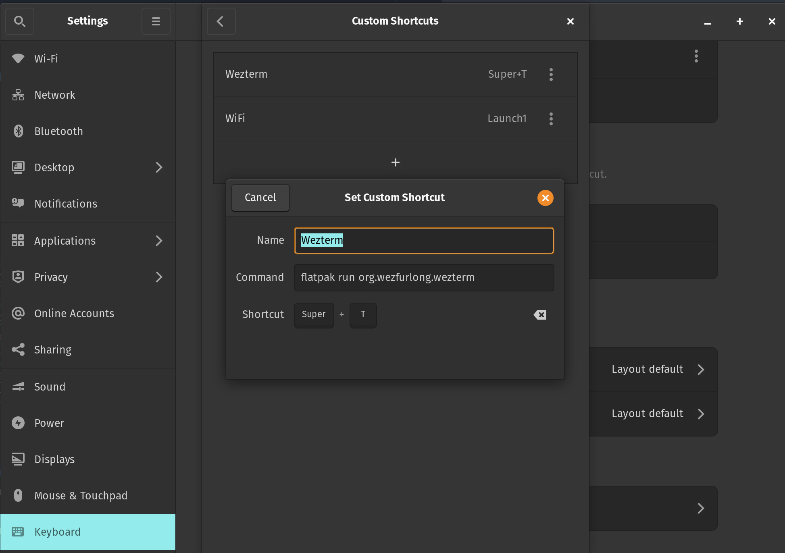

# 🛠 My Dotfiles & Package Management

This repository contains my dotfiles and configuration management using `stow`. It also documents how I installed and update my essential CLI tools using Homebrew.

---

## 📦 Installed Packages

### HomeBrew

I use **Homebrew** as my package manager for installing CLI tools. Below is a list of packages currently installed on my system:

| Package | Used by | Install Command |
|---|---|---|
| lazydocker | `ldo` alias | `brew install lazydocker` |
| yarn | JS projects | `brew install yarn` |
| yazi | `y` function | `brew install yazi` |
| tmux | terminal multiplexer | `brew install tmux` |
| zoxide | `z` jumps, sesh's folder list | `brew install zoxide` |
| sesh | `sc` / tmux `prefix + s` session picker | `brew install sesh` |
| fd | `v` / `on` file pickers, yazi | `brew install fd` |
| wl-clipboard | fzf `ctrl-y` copy (`wl-copy`) | `brew install wl-clipboard` |
| starship | zsh prompt (`~/.config/starship.toml`) | `brew install starship` |
| go | Go toolchain | `brew install go` |
| golangci-lint | Go linting, in the shell and Neovim | `brew install golangci-lint` |
| sqlc | type-safe Go from SQL | `brew install sqlc` |
| goose | database migrations | `brew install goose` |
| govulncheck | Go vulnerability scanning | `brew install govulncheck` |

`.zshrc` runs `zoxide init` unconditionally, so a new shell errors with `command not found: zoxide` until zoxide is installed.

### Apt
| Package | Used by | Install Command |
|---|---|---|
| fzf | every fuzzy picker; also ships `fzf-tmux` and the Ctrl-T/Ctrl-R/Alt-C key bindings `.zshrc` sources | `sudo apt install fzf` |
| ripgrep | `on` full-text mode, Neovim | `sudo apt install ripgrep` |
| bat | `cat` / `bat` aliases (`batcat`) | `sudo apt install bat` |
| stow | linking these dotfiles | `sudo apt install stow` |

### Wezterm
Wezterm (terminal emulator) → Installed via Cosmic Store
#### Install flathub
```bash
  flatpak install flathub
```
#### Install Wezterm
- Install Wezterm from Cosmic Store

#### Link Wezterm Configs (Need to have dotfiles repo first)
```bash
cd ~/dotfiles
stow wezterm
```
#### Set Wezterm as default for Win+t
- Open keyboard shortcuts > Custom shortcuts and kitty
  - Name : ```Wezterm```
  - Command : ```flatpak run org.wezfurlong.wezterm```
- 

### Snap
| Package       | Install Command                             |
|---------------|---------------------------------------------|
| datagrip | snap install datagrip --classic             |
| nvim | snap install nvim --classic                |
| pycharm-professional | snap install pycharm-professional --classic |
| rider | snap install rider --classic                |
| rubymine | snap install rubymine --classic             |

### Kitty
Kitty (terminal emulator) → Installed via snap or system package manager:
```sh
sudo apt install kitty
```
#### Link Kitty Configs
```bash
cd ~/dotfiles
stow kitty
```

### Neovim
Neovim → Installed via snap (see Snap table above). Requires **0.11.2+**; the snap tracks a
current release (0.12.x), which the Ubuntu apt package (0.9.5) does not satisfy.

#### Link Neovim Configs
```bash
cd ~/dotfiles
stow nvim
```

Config is [LazyVim](https://lazyvim.org) on top of
[lazy.nvim](https://github.com/folke/lazy.nvim), with **Catppuccin Mocha** as the colorscheme.
`lazy-lock.json` is tracked, so plugin revisions are reproducible across machines.

**Layout:**
```
nvim/.config/nvim/
├── lazyvim.json            # which LazyVim extras are enabled
├── lsp/easy_dotnet.lua     # Roslyn inlay hints + Neovim file watching
├── lsp/pyright.lua         # point pyright at <root>/.venv/bin/python when present
├── after/ftplugin/cs.lua   # C#: 4-space indent, no format-on-save
├── after/ftplugin/go.lua   # Go: tabs, shown 4 wide
└── lua/
    ├── config/             # options, keymaps, lazy bootstrap
    └── plugins/            # dotnet, go, graphql, markdown, python, personal (theme/lualine/gitsigns)
```

**Enabled extras:** `lang.typescript`, `lang.python`, `lang.go`, `lang.rust`, `lang.docker`, `lang.json`,
`lang.yaml`, `lang.markdown`, `linting.eslint`, `formatting.prettier`, `dap.core`, `test.core`,
`coding.mini-surround`, `editor.inc-rename`, `ui.treesitter-context`.

**Deliberate exclusions** — do not re-add without reason: OmniSharp (EasyDotnet's Roslyn is
used instead), `neotest-vstest`, Marksman, `markdownlint-cli2`,
`markdown-preview.nvim` (vulnerable Socket.IO dependency tree), and
`graphql-language-service-cli` (high-severity npm advisories in its dependency tree).

#### External tooling this config expects
`ripgrep`, `fd`, `fzf`, `lazygit`, a C compiler (`build-essential`), Node LTS, Python 3 +
venv, Go, Rust (via rustup), and the .NET SDK. Language servers and formatters are managed by Mason, not installed
globally. The C#/Blazor profile additionally uses two global .NET tools:
```bash
dotnet tool install -g easydotnet
dotnet tool install -g roslyn-language-server --prerelease
```

**Keymap:** `<leader>e` toggles the Snacks file explorer (LazyVim default).

### Go
The toolchain and backend CLIs come from Homebrew (see the table above). Install them first,
because Mason needs `go` to build some of its Go packages.

Don't use `brew install air`: that formula is an unrelated R formatter. Install Go's
hot-reload tool with `go install`; `.zshrc` puts `~/go/bin` on `PATH`.
```bash
go install github.com/air-verse/air@latest
```

Automatic installs are off (see `lua/lockdown.lua`), so on a new machine run these in Neovim:
```vim
:Lazy install
:MasonInstall gopls goimports gofumpt delve hadolint dockerfile-language-server docker-compose-language-service
:TSInstall go gomod gowork gosum dockerfile graphql
```

Pin gqlgen and libraries per project, so each repo controls its own versions. `sqlc` and
`goose` stay global, from the Homebrew table above:
```bash
go mod init example.com/service
go get -tool github.com/99designs/gqlgen   # run with: go tool gqlgen
go get github.com/jackc/pgx/v5             # Postgres driver, used by sqlc's generated code
```

### Rust
The toolchain comes from [rustup](https://rustup.rs), not Homebrew or apt. `.zshrc` puts
`~/.cargo/bin` on `PATH`.
```bash
curl --proto '=https' --tlsv1.2 -sSf https://sh.rustup.rs | sh
rustup component add rust-analyzer clippy rustfmt
```

rust-analyzer comes from rustup, not Mason. rustaceanvim (from the `lang.rust` extra) runs the
`rust-analyzer` on `PATH`, and the rustup copy always matches the installed toolchain. Until
the component is added, `~/.cargo/bin/rust-analyzer` is only a proxy that fails with
`Unknown binary 'rust-analyzer'`.

Crates that link against OpenSSL (`openssl-sys`, `reqwest` with default features) also need:
```bash
sudo apt install pkg-config libssl-dev
```

Automatic installs are off, so on a new machine run these in Neovim. codelldb is the debug
adapter the extra uses:
```vim
:Lazy install
:MasonInstall codelldb
:TSInstall rust ron
```

Keep the toolchain current with `rustup update` (and `rustup self update` for rustup itself).

---

## 🔄 Updating Homebrew & Packages
- To ensure all installed packages are up-to-date, I run:
   ```sh
   brew update && brew upgrade

- To upgrade a specific package:
   ```sh
    brew upgrade <package-name>

- To check if any packages are outdated:
   ```sh
    brew outdated

---

## ❌ Uninstalling a Package
- To remove a package installed via Homebrew:
   ```sh
    brew uninstall <package-name>

---

## 🛠 Managing Dotfiles with GNU Stow
I use GNU Stow to manage my configuration files in a structured way.

### 📌 Structure
I then use stow to create symlinks for specific applications:
```
stow lazydocker
stow yazi
stow kitty
stow wezterm
stow nvim
stow zsh
stow tmux
stow claude
```
This automatically symlinks the configurations from `~/dotfiles/` into the corresponding locations inside `~/.config/` (and `~` for dotfiles like `.zshrc`).

---

## 🔥 Removing a Dotfile Symlink
If I want to remove a dotfile symlink:
```sh
  stow -D <package>
```
---

## 🦊 Installing & Managing Firefox Developer Edition
Firefox Developer Edition is not available in most package managers or app stores, so I manually downloaded and installed it.
### 📥 Installation Process

1. **Download the latest Firefox Developer Edition tarball from the official website**:
   ```sh
   wget -O /opt/firefox-developer.tar.bz2 "https://download.mozilla.org/?product=firefox-devedition-latest-ssl&os=linux64&lang=en-US"
2. **Extract the tarball into /opt/:**
   ```sh
    sudo tar -xjf /opt/firefox-developer.tar.bz2 -C /opt/
3. **Rename the extracted folder (if needed) for consistency:**
   ```sh
    sudo mv /opt/firefox /opt/firefox-developer
4. **Create a symlink in /usr/local/bin/ for easy execution:**
   ```sh
    sudo ln -sf /opt/firefox-developer/firefox /usr/local/bin/firefox-developer
5. **Launch Firefox Developer Edition**:
   ```sh
    firefox-developer

### ❌ Uninstalling Firefox Developer Edition
- To completely remove Firefox Developer Edition from my system:
   ```sh
  sudo rm -rf /opt/firefox-developer
  sudo rm -f /opt/firefox-developer.tar.bz2
  sudo rm -f /usr/local/bin/firefox-developer

---

## 🐚 Zsh
Shell configuration managed via [Oh My Zsh](https://ohmyzsh.com) with the following setup:
- **Prompt**: [Starship](https://starship.rs) (`~/.config/starship.toml`): minimal two-line prompt, Catppuccin Mocha colours, git branch/status on the left, project language icon + version and AWS profile on the right
- **Plugins**: `git`, `zsh-autosuggestions`, `fast-syntax-highlighting`, `tmux`
- **Tools integrated**: NVM, rbenv, RVM, fzf, zoxide, Homebrew, .NET SDK, Rust (cargo), Go
- **Notable aliases**: `vi` → nvim, `ls` → lsd, `cat`/`bat` → batcat, `ldo` → lazydocker, `cld` → claude
- **Functions**:
  - `v` — fuzzy-find files (fd + fzf) and open them in `$EDITOR`
  - `on` — fuzzy-find Obsidian notes by title, or full text with `alt-f`
  - `sc` — sesh session picker (see [tmux](#-tmux))
  - `y` — yazi with cwd-tracking

`zsh-autosuggestions` and `fast-syntax-highlighting` are not bundled with Oh My Zsh:
```bash
git clone https://github.com/zsh-users/zsh-autosuggestions ${ZSH_CUSTOM:-~/.oh-my-zsh/custom}/plugins/zsh-autosuggestions
git clone https://github.com/zdharma-continuum/fast-syntax-highlighting ${ZSH_CUSTOM:-~/.oh-my-zsh/custom}/plugins/fast-syntax-highlighting
```

#### Link Zsh Config
```bash
cd ~/dotfiles
stow zsh
```
Besides `~/.zshrc`, this links the Starship prompt config (`~/.config/starship.toml`) and the fzf helper scripts `on` uses (`~/.config/fzf/`).

---

## 🪟 tmux
tmux → Installed via Homebrew (see above). Prefix is **`Ctrl+s`**.
[`tmux/TMUX_GUIDE.md`](tmux/TMUX_GUIDE.md) is the full guide to this config.

#### Link tmux Config and Install Plugins
```bash
cd ~/dotfiles
stow tmux
git clone https://github.com/tmux-plugins/tpm ~/.tmux/plugins/tpm
```
Then start tmux and press `prefix + I` to install the plugins: tmux-sensible, vim-tmux-navigator,
Catppuccin (Mocha), tmux-resurrect and tmux-continuum. Plugins live in `~/.tmux/plugins/`,
outside the repo.

#### Sessions with sesh + zoxide
[sesh](https://github.com/joshmedeski/sesh) lists running tmux sessions alongside directories
from zoxide's history, in one fzf picker:
- `sc` — from a plain shell, before tmux is running
- `prefix + s` — the same picker as a popup inside tmux

Picking a running session (grid icon) attaches to it; picking a folder (folder icon) creates a
session there, named after the folder. Needs `sesh`, `zoxide` and `fzf` installed.

#### Saving and Restoring (resurrect + continuum)
- `prefix + Ctrl-s` saves every session; continuum also saves every 10 minutes
- `prefix + Ctrl-r` restores the most recent save (auto-restore is off)

Snapshots live in `~/.local/share/tmux/resurrect/`.

---

## 🤖 Claude Code

Claude Code CLI configuration managed via stow.

**Tracked files:**
- `settings.json` — main settings (model, status line, permissions)
- `keybindings.json` — custom keybindings
- `statusline-command.sh` — status line script
- `skills/` — custom skills

**Not tracked** (machine-specific or sensitive): `.credentials.json`, `history.jsonl`, `sessions/`, `projects/`, `settings.local.json`

#### Link Claude Configs
```bash
cd ~/dotfiles
stow claude
```

---

## 🗂 Yazi
Yazi (terminal file manager) → Installed via Homebrew (see above).

**Tracked files:**
- `theme.toml` — sets the dark flavor to **Catppuccin Mocha**
- `package.toml` — flavor dependency, managed by `ya pkg` (`yazi-rs/flavors:catppuccin-mocha`)
- `flavors/catppuccin-mocha.yazi/` — the vendored flavor package itself
- `yazi.toml`, `keymap.toml` — stock upstream defaults, kept in-repo so the config is self-contained

Since `yazi.toml`/`keymap.toml` are unmodified defaults, the notable behaviour is all upstream: 1:4:3 pane ratio, alphabetical case-insensitive sort with directories first, hidden files off, vim-style navigation, `z`/`Z` for zoxide/fzf jumps, `s`/`S` to search by name (fd) or content (ripgrep).

#### Link Yazi Configs
```bash
cd ~/dotfiles
stow yazi
```

#### Shell Integration
`.zshrc` defines a `y` function that wraps yazi with `--cwd-file`, so quitting drops the shell in the last directory you browsed.

#### Changing the Flavor
```bash
ya pkg add yazi-rs/flavors:<name>   # fetch into flavors/
```
Then point `theme.toml` at it:
```toml
[flavor]
dark = "<name>"
```
